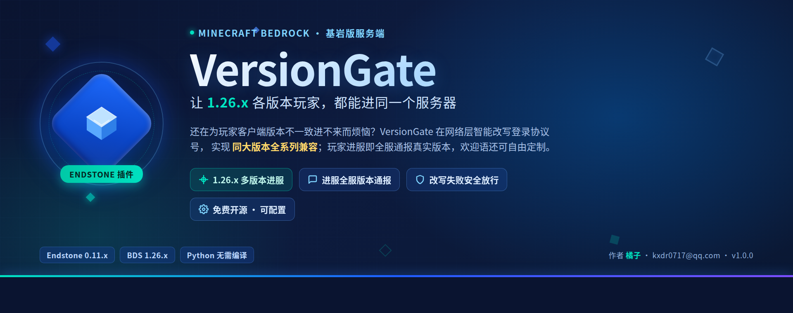

<div align="center">

# 🛡️ VersionGate

### 让基岩版 1.26.x 多版本玩家都能进服 · 进服自动全服通报版本

[](LICENSE)
[](https://endstone.dev/)
[](https://www.minecraft.net/)
[](https://www.python.org/)
[](https://github.com/xiaolojk/VersionGate/releases)



</div>

---

## 📌 简介

基岩版的跨版本逻辑和 Java 版不同：服务端绑定一个协议号，客户端版本（协议号）不一致就会被挡在门外。朋友用的是 1.26.20，你的服务器是 1.26.65，就进不来。

**VersionGate** 在网络层拦截登录握手包，把客户端上报的协议号改写为服务器协议号，相当于一个轻量版 ViaVersion，让 **1.26.x 系列各小版本都能进服**。同时读取玩家真实客户端版本，进服时全服通报。

插件基于 Endstone Python API 编写，**无需编译、无需额外依赖**，一个 `.whl` 文件丢进 `plugins/` 即可使用。

> 💻 **完全开源**：本项目**全部源代码**都在本仓库 `src/` 目录下，采用 MIT 许可，可自由查看、使用、修改与分发。Release 里的 `.whl` 只是打包产物，源码始终公开。

---

## ✨ 功能特性

| 特性 | 说明 |
|---|---|
| 🌐 **多版本进服** | 拦截 `RequestNetworkSettings` / `Login` 包，改写协议号，放行 1.26.x 全系列客户端 |
| 📢 **进服版本通报** | 玩家进服时广播 `[玩家名]该玩家是[版本]，欢迎你加入服务器！`，版本取自客户端真实上报值 |
| 🛡️ **安全兜底** | 改写失败一律原样放行，绝不因插件阻断玩家连接 |
| 🔒 **差值保护** | 只改写协议号在设定差值内的客户端，避免误伤其它版本 |
| ⚙️ **高度可配置** | 欢迎语模板、功能开关、差值、调试日志全部可通过 `config.toml` 调整 |
| 🪶 **零外部依赖** | 原生 Endstone API，不依赖任何第三方库 |

---

## 🎮 实际效果

玩家（例如版本 1.26.20）进服后，全服聊天栏显示：

```
[Steve]该玩家是[1.26.20]，欢迎你加入服务器！
```

黄色高亮，不干扰正常聊天。

---

## 📥 安装方法

1. 本插件适用于 **Endstone 0.11.x**（已在 `0.11.16` + BDS `1.26.65.1` 上测试通过）。
2. 从 [Releases](https://github.com/xiaolojk/VersionGate/releases) 下载 `endstone_versiongate-1.0.0-py2.py3-none-any.whl`。
3. 将 `.whl` 放入服务端的 `plugins/` 目录。
4. **重启服务器**，首次启动会自动在 `plugins/versiongate/config.toml` 生成配置文件。
5. 看到控制台输出即代表加载成功：

```
[Versiongate] VersionGate 已启用 | 服务器协议号=2225 | MC版本=26.65 | 版本绕行=True | 进服通报=True
```

> 如果你的运维面板支持拖拽上传 `.whl`，直接拖入后点「重启服务器」即可。

---

## ⚙️ 配置文件

首次启动后生成的 `plugins/versiongate/config.toml`：

```toml
# 是否启用版本绕行（让 1.26.x 各版本进入服务器）
enable_version_bypass = true

# 是否启用玩家进服全服通报
enable_join_announcement = true

# 进服通报消息模板，占位符：{name} 玩家名，{version} 游戏版本
announcement_template = "[{name}]该玩家是[{version}]，欢迎你加入服务器！"

# 客户端协议号与服务器协议号的最大差值，超过则不改写
# 默认 1400 可覆盖整个 1.26.x 系列
max_protocol_diff = 1400

# 是否输出详细调试日志（排查版本问题时可开启）
debug = false
```

| 配置项 | 默认值 | 说明 |
|---|---|---|
| `enable_version_bypass` | `true` | 版本绕行总开关 |
| `enable_join_announcement` | `true` | 进服通报总开关 |
| `announcement_template` | 见上 | 欢迎语模板，支持 `{name}` `{version}` |
| `max_protocol_diff` | `1400` | 允许的协议号差值，越大放行范围越广 |
| `debug` | `false` | 开启后会打印每个客户端上报的协议号 |

---

## 🔧 工作原理

1. **版本绕行**：通过 `PacketReceiveEvent` 监听客户端发来的 `RequestNetworkSettings`（包 ID `0xC1`）和 `Login`（包 ID `0x01`）包。这两个包的 payload 开头是以**大端 int32** 编码的客户端协议号。插件将其读取、与服务器协议号比对，若在允许差值内则改写为服务器协议号并写回，从而通过版本校验。
2. **真实版本读取**：进服通报使用 `PlayerJoinEvent` + `player.game_version`，取的是客户端**实际上报的版本**，不受协议号改写影响，因此显示的是玩家真实客户端版本。
3. **安全设计**：所有改写操作都包在 `try/except` 中，任何异常都原样放行，不会导致玩家掉线或服务器报错。

---

## ⚠️ 已知限制

- 本插件针对**同一大版本（1.26.x）内的小版本差异**设计。协议号改写只改变版本号字段，若客户端与服务端的数据包**结构本身发生变化**（跨度极大的版本），虽然能进服，个别新特性可能异常。
- 需要 BDS / Endstone 版本支持 `PacketReceiveEvent.payload` 的可写能力。
- 若某个版本仍进不来，把 `debug` 改为 `true` 并重启，日志会打出每个客户端上报的协议号，便于反馈问题。

---

## 📝 更新日志

### v1.0.0 (2026-11-22)
- 首次发布
- 支持 1.26.x 多版本进服（协议号改写）
- 支持玩家进服全服版本通报
- 可配置欢迎语模板、功能开关、协议差值、调试日志

---

## 🙋 作者与联系

**作者：橘子**

- 📧 邮箱：[kxdr0717@qq.com](mailto:kxdr0717@qq.com)
- 🐙 GitHub：[@xiaolojk](https://github.com/xiaolojk)

欢迎反馈问题与建议，也欢迎 Star ⭐ 和 Fork。

---

## 💻 源代码

**全部源码均已开源**，仓库即源码，可直接在线浏览或克隆：

```
src/endstone_versiongate/
├── __init__.py       # 插件入口，导出 VersionGatePlugin
├── versiongate.py    # 核心实现：协议号改写 + 进服通报（含完整中文注释）
└── config.toml       # 默认配置文件
```

克隆到本地：

```bash
git clone https://github.com/xiaolojk/VersionGate.git
```

自行构建 `.whl`（可选）：

```bash
pip install build
python -m build --wheel
# 产物在 dist/ 目录，直接丢进 plugins/ 即可
```

---

## 📄 开源许可

本项目采用 [MIT License](LICENSE) 开源，**可自由使用、修改、分发**，仅需保留版权声明。也就是说：

- ✅ 商用、私用均可
- ✅ 可修改源码二次开发
- ✅ 可重新打包发布
- ✅ 只需保留版权声明与许可文本

基于 [Endstone](https://endstone.dev/) Python 插件 API 开发，协议号字段参考 [gophertunnel](https://github.com/Sandertv/gophertunnel) 的基岩版协议定义，在此致谢。

---

<div align="center">

Made with ❤️ by 橘子 · 2026

</div>
